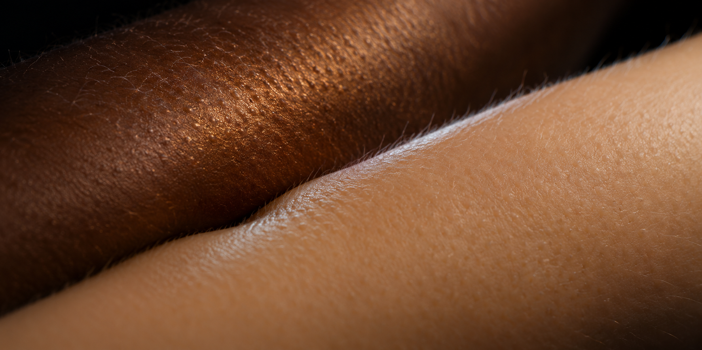

# dp-sts



An evolving audiovisual art project exploring light, touch, particles and the relationships between sound and space. Each concept can define its own production process.

Latest study: [Gujora — a continuous world](docs/experiments/gujora-cover/continuum-film.md), a 30-second, 720×720 particle film. Music direction: use Aphex Twin’s **#3** as a reference for pace, register and instrument texture while composing original music; do not insert its recording. [Visual review and evidence](docs/experiments/gujora-cover/continuum-review.md).

This repository is public. Anyone can browse the code, cover and documentation without an invitation; rendered films and audio under `runs/` remain local and are not included in the repository. Run the studio locally to browse its [artifact gallery](http://localhost:4200/gallery.html).

## Studio workspace

A working local studio and export pipeline for ambient music and audio-reactive fractal films. Nx orchestrates the workspace; pnpm owns JavaScript/TypeScript dependencies and uv owns Python dependencies.

Optional engine extension: [TouchDesigner / cables integration status](docs/engine-extension.md) and [shared audio/timeline/Fourier bundle instructions](packages/engine-bridge/README.md). Native scene rendering remains a separate validation step.

## Earlier experiment: dp-sts psytrance

[dp-sts](docs/experiments/psytrance/README.md) is a composition-specific ten-minute psytrance experiment with black-and-white dotted fractals. Its full MP4 and stereo WAV are in `runs/dp-sts-v01/`. Full-file technical verification and the independent visual review passed; auditory artistic acceptance remains pending because the tested listening tools failed their controls. See the [bound review](docs/experiments/psytrance/critique-dp-sts-final.md).

Its `media:psy-score`, `media:psy-audio`, `media:psy-visual` and `media:psy-verify` tasks use the same Nx / pnpm / uv workspace. They are a separate composition workflow; the starter studio's limits below still apply to that starter, not to every experiment.

## Start experimenting

```sh
pnpm install --frozen-lockfile
uv sync --locked --all-packages
pnpm nx dev studio
```

Open http://localhost:4200. **Prepare composition** renders the Strudel score to a stereo master. **Play** plays that master while its amplitude and frequency bands drive the Julia fractal. **Save WAV** downloads the same PCM samples. Edit the JSON score and prepare again; **Save score** downloads the normalized composition for keeping in `compositions/`.

The starter piece is a 30-second, four-chord ambient study using sine/triangle layers, slow attacks and releases, and a teal/gold Julia fractal. No remote samples or account is needed.

## Produce finished files

Run commands from the repository root. Nx builds the required apps before exporting; no development server needs to be running.

```sh
# Stereo PCM16 WAV + synchronized H.264/AAC MP4
pnpm nx run render:export --composition=compositions/quiet-orbit/composition.json

# Audio master only
pnpm nx run render:audio --composition=compositions/quiet-orbit/composition.json

# Two independent renders; compare WAV bytes, every PNG frame hash and MP4 bytes
pnpm nx run render:reproduce --composition=compositions/quiet-orbit/composition.json

# Use a specific NEW output folder, or make a short draft
pnpm nx run render:export --duration=2 --out=runs/my-draft

# Check a previous export again (including checksums)
pnpm nx run media:verify --directory=runs/my-draft
```

Default output folders have unique timestamped names under `runs/`. An existing output directory is refused, not overwritten. Failed exports retain `status.json` and partial outputs for diagnosis. Only `state: complete` means the exported files passed validation. Interrupted processes may leave `state: rendering`; those are incomplete runs.

Each video export contains:

| File                 | Purpose                                            |
| -------------------- | -------------------------------------------------- |
| `audio.wav`          | Stereo PCM16 master, 48 kHz by default             |
| `film.mp4`           | H.264 video and AAC audio, exact frame timeline    |
| `poster.png`         | Middle frame                                       |
| `composition.json`   | Normalized settings used for this render           |
| `features.json`      | Per-frame amplitude, bass, midrange and treble     |
| `frames.sha256.json` | Hash of every source PNG frame                     |
| `render.json`        | Source/environment fingerprint and artifact hashes |
| `verification.json`  | OpenCV, PCM and FFprobe results                    |
| `status.json`        | Complete, rendering or failed                      |

A reproduction run contains `a/`, `b/` and `reproducibility.json`. Keep the whole folder with the source revision and lockfiles if a work must be reproducible. `runs/` is intentionally Git-ignored: back up finished work separately.

## What is supported

- Seeded Strudel note mini-notation, two synthesized layers, filter, tempo, slow factor, attack/release, gain and fades.
- Julia fractal iteration, zoom, motion speed, color, seed and audio response. `reactivity: 0` disables audio modulation.
- Stereo 44.1 or 48 kHz WAV. Even frame dimensions up to 1920×1080, 24/25/30/60 fps, durations 1–300 seconds with a whole number of frames.
- One shared audio master and fractal renderer for preview/export. Preview follows the audio clock and may skip frames if the browser is busy; export renders every frame.
- OpenCV decodes and validates the finished video. WebGL draws the fractal; OpenCV is not a second, divergent fractal renderer.

Reproducibility is **verified for a fixed environment**, not promised across GPUs/operating systems or updated Chrome/FFmpeg versions. The `reproduce` command fails if the two environments or any artifact/frame differs. Do not edit source or settings during that check. The shader is stateless, the score is seeded, and FFmpeg uses a single encoding thread. Chrome and FFmpeg are machine prerequisites whose versions are recorded, not installed or pinned by pnpm/uv.

This is a bounded production pipeline, not a DAW: arbitrary Strudel JavaScript, imported sample libraries, microphone input, live performance recording, mastering/loudness targets, and browser MP4 download are not implemented. MP4 production is a CLI workflow. The final sample is a starting study, not a claim of release-ready music mastering.

## Workspace and validation

```text
apps/studio/             Interactive composition, preview, WAV download; built render host
apps/render/             Node export runner; Playwright, FFmpeg and reproducibility check
packages/audiovisual/    Composition validation, Strudel audio, PCM, features, Julia shader
python/media/            uv package: OpenCV/PCM/FFprobe output validation and diagnostics
compositions/            Saved artwork settings (not one Nx project per experiment)
assets/                  Source-media guidance
runs/                    Ignored per-run media and evidence
docs/                    Setup, architecture and verification records
```

```sh
pnpm nx show projects
pnpm nx graph
pnpm run check
pnpm run doctor
pnpm run inspect
# With Studio running:
pnpm nx run render:smoke
```

`render:smoke` uses real Chrome to test silent initial state, invalid JSON recovery, actual preparation/playback, moving visuals, WAV download, stop/restart, automatic completion, repeated preparation, accessibility and mobile layout. Screenshots are in `runs/verification/`. Set `STUDIO_URL` for another server address. Use `pnpm run doctor` explicitly; `pnpm doctor` is pnpm's unrelated built-in command.

Use pnpm 11.25.0 and uv. pnpm manages the local Node 22.22.2 runtime through `devEngines.runtime`; `.python-version` selects Python 3.12. `CHROME_PATH` can select a specific installed Chrome executable. JS/Python libraries are locked in `pnpm-lock.yaml` and `uv.lock`.

Use Nx generators for projects and task scaffolding; pnpm/uv commands for dependencies and locks. Edit custom music, shader, application code, task dependencies and artwork settings directly. See [CLI provenance](docs/setup-cli.md) and [production verification](docs/production-verification.md).

No remote repository, Nx Cloud connection, or deployment is configured. Strudel declares AGPL-3.0-or-later; its license applies to software use/distribution according to its terms.
